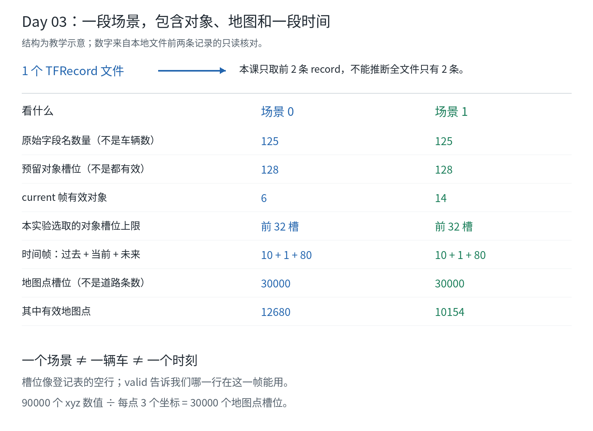

# Day 03：一个 TFRecord 里，什么才是“一个场景”

## 状态与范围

- 计划日期：2026-11-10，可按学习进度提前或顺延。
- 实际讨论日期：2026-11-08（Asia/Singapore；更正草稿误用的时区日期）。
- 学习状态：`IN_PROGRESS`，学习者表示继续 Day 03；尚未收到本课独立解释。
- 学习者本课命令执行：`NOT_RUN`，收到结果后再补，不预填完成。
- 助手核对：只读本地文件的前两条记录与选定解析器源码，未仿真、未训练、
  未初始化 JAX 后端，TensorFlow 无可见 GPU；没有新增实验运行目录。
- Day 01/02 的验收不因继续 Day 03 自动补勾，已知操作与理解状态仍分别保留。

本课继续使用本机已有测试文件，不下载正式 Waymo 数据集、不改原文件。

## 1. 先建立一个层次

把 TFRecord 想成一本资料册，一条 record 是其中一段交通记录。
本课只读前两条，不表示整个文件就只有两条。

```text
一个本地 TFRecord 文件
    |
    +-- record 0：一段交通场景，有自己的 scenario ID
    |       +-- 地图点：道路几何等静态信息
    |       +-- 对象槽位：各对象的身份、尺寸、位置和有效性
    |       +-- 时间帧：过去、当前、未来的记录
    |
    +-- record 1：另一段交通场景，另一个 scenario ID
    |       +-- 另一份地图、对象与时间记录
    |
    +-- 本课没有继续遍历后面的记录
```



图的结构是讲解示意；数字来自本机前两条记录的只读核对。

**场景不是一辆车，也不是某一帧。** 一段场景可以有很多交通参与者，
并记录它们随时间的变化。一个场景转换后可以成为一份 SimulatorState，
不等于一条 record 就训练出一个模型。

## 2. 先打开自己的编号表

不用重新运行检查，复用你已有的盘点目录：

```bash
cd /home/my/workspace/autodrive/my-ad
P1_RUN=/home/my/workspace/autodrive/my-ad/artifacts/waymax/learning-20261107T152431Z-ym466a_w
cat "$P1_RUN/records.json"
```

先只认三项：

```json
{
  "index": 0,
  "scenario_id": "d27157fded0ddd5e",
  "feature_count": 125
}
```

上面从实际记录摘出三个字段，省略了其余字段，不是完整文件。

| 字段 | 解释 | 不是 |
| --- | --- | --- |
| `index` | 我们选中记录中的序号；这里是 0/1 | 时间秒数、车辆 ID |
| `scenario_id` | 这一段交通场景的身份编号 | 模型名称、速度或评分 |
| `feature_count` | 原始 record 中字段名的数量 | 车辆数量、训练样本条数 |

两个真实 ID：

| 记录 | ID | 本教学实验的角色 |
| --- | --- | --- |
| 0 | `d27157fded0ddd5e` | 训练场景和动作对照 |
| 1 | `543908aa309f5a0b` | 开发/验证场景，不参加本轮模型训练 |

第二个场景已经被反复观察，因此不是严格盲测集。

## 3. “125 个字段”与“128 个对象”为什么不一样

一个字段就像表格的一列。例如这些实际存在的字段：

| 字段名 | 中英文意思 | 内容示意 |
| --- | --- | --- |
| `scenario/id` | 场景编号 Scenario ID | 这一段记录的 ID |
| `state/id` | 对象编号 Object ID | 各对象槽位对应的编号 |
| `state/is_sdc` | 是否自车 Is SDC | 标记哪个槽位是自车 |
| `state/current/x` | 当前横坐标 Current X | 每个对象当前的 x |
| `state/current/valid` | 当前是否有效 Current Validity | 这一帧该对象的记录能否使用 |
| `roadgraph_samples/xyz` | 地图点坐标 Roadgraph XYZ | 地图采样点的 x/y/z |

**125 是有多少种字段；128 是某些对象字段预留多少个槽位。**
同一张表可以有很多列，也有很多行，这两个数不用相同。
所以 `feature_count=125` 不是车辆数量。

TFRecord 的原始字段可以是一长串数值，解析器根据 schema 还原成数组维度。
不能仅凭字段值列表很长，就把所有数都当成独立车辆。

还要分清：原始 `feature_count=125` 与我们小模型的 120 维输入特征不是同一概念。
前者数原始字段名，后者是 `features_from_state` 另外整理的一串模型输入数值。

## 4. 对象槽位不等于实际有那么多辆车

本地两条记录各预留 **128 个对象槽位**。槽位是格式容量，
像一张有 128 行的登记表；不是每行在每一帧都有有效对象。
对象也不一定都是车辆，还可能有行人等类别。

本次只读核对：

| 计数 | 记录 0 | 记录 1 |
| --- | ---: | ---: |
| 原始对象槽位 | 128 | 128 |
| `current` 这一帧有效对象 | 6 | 14 |
| 本实验按配置取前多少个槽位 | 32 | 32 |
| 前 32 槽中 `current` 有效对象 | 6 | 14 |
| 自车所在槽位，索引从 0 开始 | 2 | 1 |

所以，不应把配置里的 `max_num_objects=32` 读成“这两段记录各有 32 辆车”。
这里的标准解析器按配置切取对象数组的前 32 槽，不是自动找最近 32 辆车，
也不是自动选 32 个有效对象；本实验另检查选定子集中恰有一辆自车。

本表的 **6 和 14 只对应 current 帧**。未来帧可能有人进入或离开，
不能据此宣布整段场景始终只有这些对象。
`valid` 必须连同对象和时刻一起读，不能只看坐标有没有数。

## 5. 一段场景不是一张照片，而是一小段时间

选定原始格式在本地两条记录中均有：

```text
10 帧过去 past + 1 帧当前 current + 80 帧未来 future = 91 帧
```

以当前帧为中间参考：

```text
过去记录             当前                  后续参考记录
[10 帧]              [1 帧]                [80 帧]
          原始数据提供的完整时间信息
```

本地实验先用过去加当前的 11 帧初始化，再推进后面的 80 步。
具体 reset/timestep 下一课细看，今天先记“帧是时刻，对象是参与者，场景包含二者”。
**91 帧不是 91 辆车，也不等于需要再执行 91 次 step。**

原始数据有 future，不意味着学习模型可以直接拿未来参考动作或未来 GT 作输入。
expert 会用下一帧记录制作参考动作；学习策略的观测范围由特征提取代码单独限制。

## 6. 90000 个地图数值是什么

`records.json` 里有：

```json
"roadgraph_xyz_values": 90000
```

每个地图点包含 x、y、z 三个坐标值：

```text
90000 个坐标数值 / 每点 3 个值 = 30000 个地图点槽位
```

**不是 90000 条路，也不是 90000 辆车。**
地图点同样有 `valid`，填满的数组容量不等于每个点都有效。

本地只读核对：记录 0 有效地图点 12680，记录 1 有效地图点 10154，
各自的数组仍保留 30000 个点槽位。

`path_xyz_values=18000` 是另外一组路径坐标数值。
本地配置按 `30 条候选路径 × 200 点 × 3 坐标` 解释它，
不是 18000 条路线，也不保证候选路径的每个点都有效。
今天不需要先研究这些候选路径的生成算法。

## 7. 为什么要保存两个 SHA256

从自己的 `environment.json` 找：

```text
data_sha256：整个本地 TFRecord 文件的内容指纹
```

从 `records.json` 找：

```text
record_sha256：本次选中某一条原始 record 的内容指纹
```

类比整本资料册与其中某一页，指纹覆盖的范围不同。
它们不需要相同，不是准确率，也不是密码。

本次文件指纹：

```text
aba63d14b00d133803db04f49a3263447beafd8ca3010ea535ca7dfff0635ba5
```

可只读复核：

```bash
sha256sum ../waymax/waymax/dataloader/testdata/tfrecord_with_routes
```

这个命令只读文件，不会训练、仿真或改数据。
记录 0/1 的指纹不同、ID 不同，说明这次选中的原始记录不是重复内容；
这仍不证明它们在所有统计意义上相互独立。

## 8. 今天的词表

| English | 中文 | 记法 |
| --- | --- | --- |
| TFRecord | TensorFlow 记录文件格式 | 装多条记录的容器 |
| Record | 记录 | 本例中一条场景资料 |
| Scenario / Scenario ID | 场景 / 场景编号 | 一段交通情况及其身份 |
| Field / Schema | 字段 / 字段结构约定 | 数据有哪些列、怎样解释 |
| Object / Slot | 对象 / 槽位 | 参与者与预留位置不相同 |
| Frame / Timestep | 时间帧 / 时间索引 | 同一个对象在不同时刻的状态 |
| Valid / Validity Mask | 有效 / 有效性标记 | 该对象或地图点的数据能否在此处使用 |
| Roadgraph | 道路图采样信息 | 记录道路几何等信息的点 |
| Shape | 数组形状 | 多少对象、多少帧、多少坐标值 |
| SHA256 / Digest | 内容指纹 | 检查指定内容有没有变 |

## 9. 当天操作与验收

学习者先执行三条只读操作即可，不新增实验目录：

```bash
cd /home/my/workspace/autodrive/my-ad
P1_RUN=/home/my/workspace/autodrive/my-ad/artifacts/waymax/learning-20261107T152431Z-ym466a_w
cat "$P1_RUN/records.json"
cat config/waymax/learning.json
sha256sum ../waymax/waymax/dataloader/testdata/tfrecord_with_routes
```

把实际输出、日期和自己的解释补在这里；没有操作前不自动完成：

| 验收问题 | 自己的解释 | 状态 |
| --- | --- | --- |
| 场景、对象、时间帧分别是什么？ | 待填写 | NOT_VERIFIED |
| `feature_count=125` 为什么不是 125 辆车？ | 待填写 | NOT_VERIFIED |
| 原始 128 槽、配置 32 槽、当前有效 6/14 有何区别？ | 待填写 | NOT_VERIFIED |
| 90000 个 xyz 数值对应多少地图点槽位？ | 待填写 | NOT_VERIFIED |
| 整文件与单记录的 SHA256 分别检查什么？ | 待填写 | NOT_VERIFIED |

助手的只读核对没有改原数据；本页保留实际输入指纹和现有记录 ID。
学习验收以学习者的操作与解释为准，不因课单里已给示例就记为 VERIFIED。
下一课 Day 04 再看：reset 如何把记录变成起点，step 如何推进时间和车辆。
