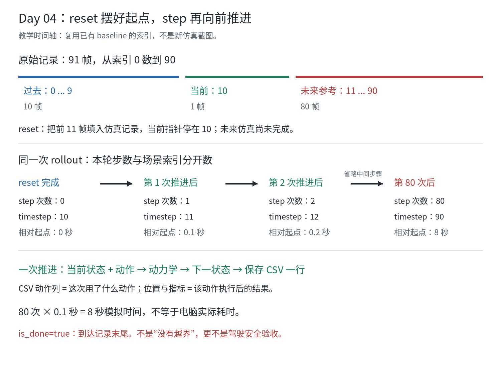

# Day 04：reset 放好起点，step 再往前走一步

## 状态与范围

- 计划日期：2026-11-11，可提前或顺延。
- 实际讨论日期：2026-11-08（Asia/Singapore）。
- 学习状态：`IN_PROGRESS`；学习者命令执行：`NOT_RUN`；理解：`NOT_VERIFIED`。
- 本课实验预期：`READING_ONLY`。助手只读已有源码、配置与轨迹，
  没有重新仿真、训练或新增实验运行目录，也没有初始化 JAX/TF/GPU。
- 前几课的验收仍按各自证据保留，不因继续本课自动补记完成。

本课先复用已有 baseline，不必重跑 `make waymax-baseline`。
30 天计划中的独立运行要求仍保留，之后亲自执行时再记录新的命令与 RUN_DIR。

## 1. 想成“从录像的某个时刻开始练习”

原始日志像一段已录好的交通录像，保留参考事实。
仿真则像在旁边另开一张练习记录表：

```text
log_trajectory：参考记录，保留原来各时刻发生了什么
sim_trajectory：仿真记录，保存这次练习算出的状态
```

`reset` 先把练习起点摆好；`step` 接收一个动作，计算下一时刻。
这只是帮助理解的类比，Waymax 本课处理的是状态数组，不是播放视频、
渲染摄像头图像或控制实体车。



图是教学时间轴；索引来自本机配置、选定源码和既有 baseline，
不是新仿真截图。

## 2. 为什么起点是 10，不是 0 或 11

上一课的原始场景有：

```text
帧索引       0 ... 9      10          11 ... 90
原始含义     10 帧过去    1 帧当前    80 帧未来参考
                          ^
                          reset 后从这里开始练习
```

配置为 `init_steps=11`，表示用 **11 帧**初始化，索引从 **0** 开始：

```text
前 11 帧 = 索引 0 到 10
reset 完成后的 timestep = 11 - 1 = 10
```

源码的具体做法是：

1. 把 `sim_trajectory` 先设为无效，把内部索引设为 `-1`。
2. `update_state_by_log(..., 11)` 把日志的索引 0 到 10 填入仿真记录。
3. 当前指针变成 `-1 + 11 = 10`，等待第一个动作。

初始化保留日志本来的有效性标记，并不把原本无效的对象变成有效。
索引 11 到 90 的仿真部分此时仍未完成；不能把日志中已有 future
读成“策略已经开完了未来”。

**reset 不是训练，不会改 TFRecord，也不会删掉已经保存的旧结果。**
它重建这次仿真的起始状态，不把未来参考直接当成自车已算出的轨迹。

## 3. step 到底做了什么

只看第一次推进：

```text
当前 state，timestep=10
    -> 策略根据当前状态选动作
    -> 动力学根据当前状态和动作计算下一状态
    -> 返回新 state，timestep=11
    -> 保存第 1 行 CSV：本次动作 + 动作后的坐标与指标
```

本实验控制自车 SDC；其它对象 NPC 使用日志回放，
不是所有参与者都由我们的策略控制，也不表示它们会智能避让自车。
expert 可用下一帧日志反推参考动作；这不等于学习策略可以把未来答案作为输入。

先不背公式，记住角色分工：

- 策略 Policy：选这次的控制动作。
- 动力学 Dynamics：算动作执行后的位置、速度和朝向。
- `step`：调用动力学、更新仿真轨迹，把时间索引加 1。

本地 `Lab.rollout` 在 `state = self.step(state, action)` **之后**读取位置和指标。
所以 CSV 一行可以读成：

> 执行这一行动作后，自车到了这一行的位置。

它不是“在这一行的位置才开始执行这个动作”。

## 4. step、timestep、秒，分开数

| 时点 | 本轮已执行 step 次数 | 场景 timestep | 相对 reset 起点的模拟时间 |
| --- | ---: | ---: | ---: |
| reset 完成 | 0 | 10 | 0 秒 |
| 第一次推进后 | 1 | 11 | 0.1 秒 |
| 第二次推进后 | 2 | 12 | 0.2 秒 |
| 第 80 次推进后 | 80 | 90 | 8.0 秒 |

本地选用的 `InvertibleBicycleModel()` 默认 `dt=0.1` 秒。
`dt` 来自动力学构造函数默认值，不是 `learning.json` 中另有一个同名字段。

```text
本轮第 n 次推进后：timestep = 10 + n
从 reset 起点算的模拟时间 = n × 0.1 秒
80 次推进 = 8 秒模拟时间，不是 80 秒
```

91 帧对应索引 0 到 90。初始化已占用 0 到 10；
后面需要的是从 10 到 90 的 **80 次转换**，不是再执行 91 次 step。
0 到 10 是 11 个采样点、10 个间隔，不能算成 1.1 秒。

模拟时间 Simulation Time 是场景里经过的时间；
实际耗时 Wall-clock Time 是电脑完成运算花的时间，可能不同。
已有 baseline 的约 12.028 秒耗时覆盖整次运行，包括两场景、初始化和文件输出，
不能当成单个场景的 8 秒，也不能仅凭它评价实时性能。

## 5. 从已有文件亲眼核对

在仓库根目录执行以下只读命令，不会启动仿真：

```bash
cd /home/my/workspace/autodrive/my-ad
BASELINE_RUN=artifacts/waymax/learning-20261107T163242Z-3nn37_xl
cat "$BASELINE_RUN/expert-0/summary.json"
head -n 4 "$BASELINE_RUN/expert-0/trajectory.csv"
tail -n 2 "$BASELINE_RUN/expert-0/trajectory.csv"
```

| 命令 | 做了什么 | 你先看什么 |
| --- | --- | --- |
| `BASELINE_RUN=...` | 给已有目录起个变量名，不创建目录 | 不是只有 inventory 的 P1 目录 |
| `cat ...summary.json` | 显示仿真摘要 | 起点 10、终点 90、80 步 |
| `head -n 4 ...csv` | 显示开头 4 行 | 1 行表头 + 3 行结果，不是 4 个 step |
| `tail -n 2 ...csv` | 显示末尾 2 行 | step 79/80 对应 timestep 89/90 |

现有场景 0 的实测摘录，坐标显示时四舍五入：

| step | timestep | x_m | y_m |
| --- | --- | --- | --- |
| 1 | 11 | 1178.631 | -1846.522 |
| 2 | 12 | 1177.568 | -1846.657 |
| 80 | 90 | 1099.803 | -1854.802 |

没有 `step=0` 的 CSV 行是正常的：这个文件只写推进后的结果，
reset 的起点由 `summary.json` 中的 `initial_timestep=10` 表示。
`x_m` 变小、`y_m` 为负不自动代表倒车或失败；它们是全局坐标。

这份已有运行的 `environment.json` 记录为 `jax_backend: "cpu"`、
`tensorflow_visible_gpus: []`。它说明那次运行的后端设置；
今天的 `cat/head/tail` 只是读文件，本身不加载 JAX 或 TensorFlow。

## 6. is_done=true 为什么不是“考试通过”

本地源码的判断相当于：

```text
is_done = (timestep + 1 >= 总帧数)
最后：90 + 1 >= 91，所以 true
```

它只表示已经到达记录的时间末尾。
一个一直越界的策略，也可能走到末尾并返回 `is_done=true`。
是否越界、重叠或偏离日志，要另看有效指标；
即使这些小样本指标很好，也不是驾驶安全验收。

## 7. 为什么换策略前要重新 reset

以后比较 expert 与固定制动动作，不能这样：

```text
expert 已经走到 90 -> 直接切换成 brake -> 当成同起点对照
```

而应分别：

```text
同一 scene -> reset 到 10 -> expert -> 记录结果
同一 scene -> reset 到 10 -> brake  -> 记录结果
```

这样才能把轨迹差异归因于不同动作，而不是起点不同。
还需保持源码、数据、配置等条件一致。本课只解释原则，不执行制动对照。

## 8. 词表与源码入口

| English | 中文 | 本课的具体意思 |
| --- | --- | --- |
| Reset / Initialization | 重置 / 初始化 | 从日志摆好本次练习起点 |
| State / SimulatorState | 状态 / 仿真状态 | 包含轨迹、地图、时间索引等的数据结构 |
| Step / Transition | 推进一步 / 状态转换 | 根据动作从当前状态得到下一状态 |
| Timestep / Index | 时间步索引 / 下标 | 指向场景的第几帧，不是秒 |
| dt / Time Interval | 时间间隔 | 本实验每次推进对应 0.1 秒 |
| Rollout | 连续推演 / 一段仿真 | 从起点反复选择动作并 step |
| Logged / Simulated Trajectory | 日志 / 仿真轨迹 | 原始参考记录 / 本次计算结果 |
| Done / Termination | 结束 / 终止 | 本例到达时间末尾，不代表安全通过 |

可选源码阅读，暂时看不懂 Python 也可先完成上面的表格：

- `config/waymax/learning.json`：`init_steps=11`、`rollout_steps=80`。
- `scripts/waymax/lab_runtime.py`：`Lab.__init__` 选择动力学，
  `Lab.rollout` 先 reset，再选择动作、step、写行。
- `../waymax-my/waymax/env/base_environment.py`：
  `BaseEnvironment.reset` 和 `BaseEnvironment.step`。
- `../waymax-my/waymax/datatypes/simulator_state.py`：
  `update_state_by_log` 和 `SimulatorState.is_done`。
- `../waymax-my/waymax/dynamics/bicycle_model.py`：
  `InvertibleBicycleModel.__init__` 的 `dt=0.1` 默认值。

上述相对源码路径以仓库根目录为参照。
本页整理时仓库 HEAD 为 `2403722721d99f6551be4151db71f1872b081ea7`，
工作区有未提交的 Day 03/04 教学修改；不是声称本课已经进入该提交。
当前配置 SHA256：

```text
35526df05513e87939c6b45c006e185552be697632c526dabea1297c0d08515c
```

旧运行当时的代码和输入身份仍以它自己的 `code.json`、`environment.json`
为准，不用今天的 HEAD 覆盖旧证据。

## 9. 学习验收

助手已经只读核对上面的源码、summary 与 CSV 首尾行，命令退出码为 0。
这是旧结果复核，不是新一次 baseline 成功。
2026-11-08 另执行 `make test-waymax`：40 项测试通过，退出码 0；
包含两份旧 baseline 的行数与逐行 step/timestep 对照，以及文档链接和图片检查。
`git diff --check` 通过；静态时间轴图已检查，无文字遮挡。
这些检查没有替学习者执行当天操作，也没有运行新的驾驶仿真。

| 问题 | 学习者自己的解释 | 状态 |
| --- | --- | --- |
| 11 帧初始化为什么停在索引 10？ | 待填写 | NOT_VERIFIED |
| CSV 的第一行位置在动作之前还是之后？ | 待填写 | NOT_VERIFIED |
| 80 次 step 后的 timestep 与模拟秒数分别是多少？ | 待填写 | NOT_VERIFIED |
| `is_done=true` 能否说明没有越界？为什么？ | 待填写 | NOT_VERIFIED |
| 两种策略为什么要从同一个 reset 起点比较？ | 待填写 | NOT_VERIFIED |

学习者实际执行日期、输出、退出码与自己的解释：待补，仍为 `NOT_RUN`。
没有收到独立回答前，不把本课改成 VERIFIED。
下一课 Day 05 看动作本身：加速度、转向曲率，以及它们的单位。
