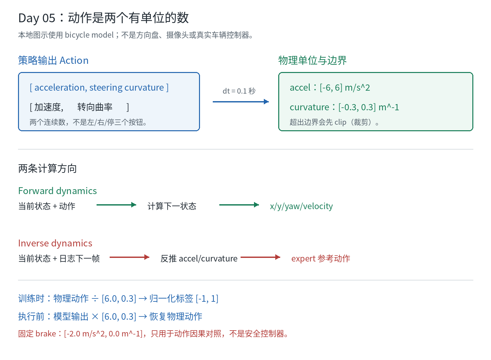

# Day 05：动作是什么，单位怎么读

## 状态与范围

- 计划日期：2026-11-12，可提前或顺延。
- 实际讨论日期：2026-11-08（Asia/Singapore）。
- 学习状态：`IN_PROGRESS`；学习者命令执行：`NOT_RUN`；理解：`NOT_VERIFIED`。
- 本课实验预期：`READING_ONLY`。助手只读已有源码、CSV 和配置，
  没有重新仿真、训练、安装依赖或使用 GPU。
- 本课复用 baseline：
  `artifacts/waymax/learning-20261107T163242Z-3nn37_xl/`。

今天只回答一个问题：

> 策略输出的两个数分别是什么，程序怎样把它们变成下一时刻的车辆状态？

## 1. 动作不是“左转/右转”三个按钮

本实验的动作是两个连续数：

```text
action = [acceleration, steering_curvature]
       = [加速度,       转向曲率]
```



图中“方向盘角度”只是常见说法；本实验的第二个数不是方向盘转了多少度，
而是车辆运动模型使用的曲率。

### 加速度 Acceleration

- 单位：`m/s²`（米每二次方秒）。
- 正数：让速度增加。
- 负数：让速度减少。
- 例如 `-2.0 m/s²` 表示每秒速度减少约 2 m/s；本实验每步只有
  `dt=0.1 s`，所以简单速度变化约为 `-2.0 × 0.1 = -0.2 m/s`。

### 转向曲率 Steering Curvature

- 单位：`m⁻¹`（每米），不是角度 `°`，也不是方向盘圈数。
- 曲率可理解为弯曲程度：`curvature = 1 / turning_radius`。
- 曲率为 `0` 表示这一项不让车辆改变朝向。
- `0.3 m⁻¹` 对应的理想圆周半径约为 `1 / 0.3 = 3.33 m`；
  这是模型动作边界的几何量，不是本地道路一定允许的转弯半径。

正负号的“左/右”要结合车辆当前朝向和坐标系判断。
不能只看数字为正就断言屏幕上一定向左；这里记录的是全局运动模型的曲率符号。

## 2. 本地模型的物理边界

`InvertibleBicycleModel(dt=0.1, max_accel=6.0, max_steering=0.3,
normalize_actions=False)` 使用物理单位动作：

```text
acceleration range = [-6.0, 6.0] m/s²
curvature range    = [-0.3, 0.3] m⁻¹
```

| 动作分量 | 最小值 | 最大值 | 单位 |
| --- | ---: | ---: | --- |
| `acceleration` | `-6.0` | `6.0` | `m/s²` |
| `steering_curvature` | `-0.3` | `0.3` | `m⁻¹` |

forward dynamics 会先把动作裁剪到这个范围（`clip`），再计算下一状态。
因此，动作超过边界时不能靠“传一个更大的数”获得更强控制；实际进入模型的
是裁剪后的值。当前配置没有把这两个边界写进 `learning.json`，它们来自
动力学类的默认参数。

## 3. 一步正向计算做什么

当前状态里有位置、速度和朝向。输入动作后，模型按一个 `dt=0.1` 秒的时间段
更新：

```text
new_x    = x    + vel_x * dt + 0.5 * accel * cos(yaw) * dt²
new_y    = y    + vel_y * dt + 0.5 * accel * sin(yaw) * dt²
new_yaw  = yaw  + curvature * (speed * dt + 0.5 * accel * dt²)
new_vel  = speed + accel * dt
```

这是代码中的简化自行车模型（bicycle model）更新。它不是摄像头、激光雷达
或真实车辆底盘控制器。`step` 会把这次更新写入 `sim_trajectory` 的下一帧。

用一个只看速度的例子：

```text
当前速度 8 m/s
加速度 -2 m/s²
dt 0.1 s
下一速度约为 8 + (-2 × 0.1) = 7.8 m/s
```

位置和朝向还要使用完整公式；不要只用速度式替代整个模拟器。

## 4. expert 动作从哪里来

expert 不是另一个神经网络，也不是把未来坐标直接复制到仿真轨迹。
在当前 `timestep`，源码做的是：

```text
当前 sim_trajectory[timestep]
              +
日志 log_trajectory[timestep + 1]
              |
              v
      inverse dynamics（逆动力学）
              |
              v
      反推出 accel 和 curvature
```

逆动力学的核心关系是：

```text
accel = (new_speed - speed) / dt
curvature = change_in_yaw
             / (speed * dt + 0.5 * accel * dt²)
```

然后这个动作再交给正向动力学 `step`，让仿真状态向下一帧日志靠近。
因此 expert 是“利用日志下一帧制作的参考动作”，属于 oracle / teacher
（参考答案），不是可以直接部署到未知道路的策略。

这也解释了为什么 Day 04 强调每个 rollout 要从同一个 `reset` 开始：
否则 expert 和 brake 的动作可能是在不同状态上比较。

## 5. CSV 里的动作是物理单位

已有场景 0 的 `expert-0/trajectory.csv` 中：

| 统计 | `accel_m_s2` | `steering_curvature_m_inv` |
| --- | ---: | ---: |
| 最小值 | `-1.73334` | `-0.008003` |
| 最大值 | `1.96932` | `0.003827` |
| 单位 | `m/s²` | `m⁻¹` |

场景 1 的对应范围为：

```text
accel：-1.52026 到 0.60299 m/s²
curvature：-0.007983 到 0.007976 m⁻¹
```

它们都远小于模型边界 `6.0` 和 `0.3`。这只是这两段记录中的动作范围，
不是车辆能力证明，也不是安全阈值。

可用以下只读命令查看实际字段：

```bash
cd /home/my/workspace/autodrive/my-ad
BASELINE_RUN=artifacts/waymax/learning-20261107T163242Z-3nn37_xl
head -n 4 "$BASELINE_RUN/expert-0/trajectory.csv"
```

每行中的 `accel_m_s2`、`steering_curvature_m_inv` 是**这一步使用的物理动作**；
同一行的 `x_m`、`y_m` 是动作执行后的结果。

## 6. 为什么训练时又出现 `[-1, 1]`

代码保留了一个清晰的缩放边界：

```text
物理动作上限 action_scale = [6.0, 0.3]
训练标签 normalized_target = physical_action / action_scale
模型输出 normalized_action ∈ [-1, 1]
送入 step 前 physical_action = normalized_action × action_scale
```

例如：

```text
expert 加速度 1.9693 m/s²
归一化标签约为 1.9693 / 6.0 = 0.3282

expert 曲率 -0.0080 m⁻¹
归一化标签约为 -0.0080 / 0.3 = -0.0267
```

所以要区分两种文件：

| 位置 | 数值含义 |
| --- | --- |
| `trajectory.csv` 的动作列 | 物理单位，便于人读 |
| `arrays.npz` 的 `targets` | 训练用归一化动作 |
| `TinyPolicy` 最后一层 | 两个归一化输出，`tanh` 约束在 `[-1,1]` |
| 调用 `step` 前 | 乘回 `[6.0, 0.3]`，恢复物理动作 |

归一化不是“动作变弱了”，而是训练时使用更统一的数值范围。

## 7. 固定 brake 到底是什么

本地对照分支指定：

```text
physical action = [-2.0 m/s², 0.0 m⁻¹]
normalized form = [-2.0 / 6.0, 0.0] ≈ [-0.3333, 0.0]
```

它只是一个人为固定控制，用于验证“动作是否会改变轨迹”。
它不是带有前车感知、停车距离、交通规则和碰撞保护的安全制动器，
更不是安全控制器。
轨迹改变只能证明控制接入了动力学，不能证明这个动作策略合理。

## 8. 词表

| English | 中文 | 记法 |
| --- | --- | --- |
| Action | 动作 | 一步要施加的控制数值 |
| Acceleration | 加速度 | 改变速度，单位 `m/s²` |
| Steering curvature | 转向曲率 | 改变朝向，单位 `m⁻¹` |
| Physical action | 物理动作 | 直接送入动力学的单位数值 |
| Normalized action | 归一化动作 | 按最大值缩放到约 `[-1,1]` |
| Forward dynamics | 正向动力学 | 动作和当前状态推算下一状态 |
| Inverse dynamics | 逆动力学 | 两个相邻状态反推动作 |
| Clip | 裁剪 | 将动作限制在允许边界内 |
| Action scale | 动作缩放 | 本地为 `[6.0, 0.3]` |
| Expert / Oracle | 参考策略 / 参考答案 | 使用下一帧日志反推动作 |

## 9. 学习验收

助手已只读检查源码、两个 expert CSV 的动作范围和既有配置；没有新仿真。
Day 05 仍不能标记为 `VERIFIED`，直到学习者能用自己的话回答：

| 问题 | 学习者自己的解释 | 状态 |
| --- | --- | --- |
| `accel_m_s2` 和 `steering_curvature_m_inv` 的单位分别是什么？ | 待填写 | NOT_VERIFIED |
| 为什么第二个动作不是方向盘角度？ | 待填写 | NOT_VERIFIED |
| expert 为什么需要 `timestep+1` 的日志？ | 待填写 | NOT_VERIFIED |
| CSV 的物理动作和 `arrays.npz` 的 targets 有什么区别？ | 待填写 | NOT_VERIFIED |
| `[-2, 0]` brake 对照能证明什么，不能证明什么？ | 待填写 | NOT_VERIFIED |

本课没有新增 RUN_DIR；源码和旧结果仍以各自记录的 hash/身份为准。
下一课 Day 06 看指标和有效帧，重点是为什么 `mean=0` 不能自动读成“没有事故”。
