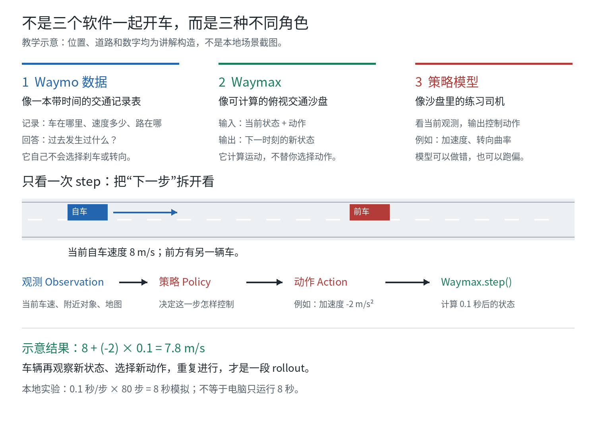
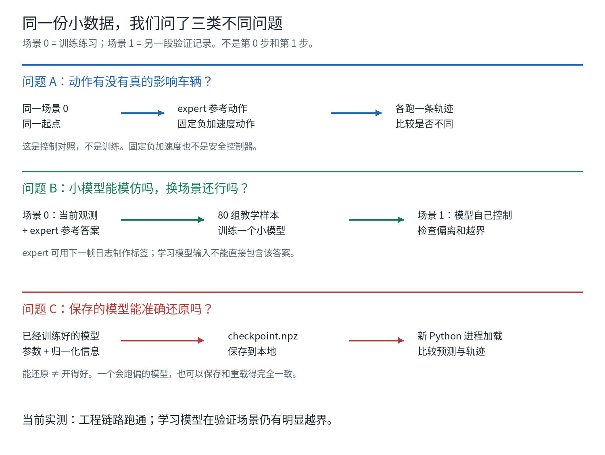

# 从零理解：谁在记录，谁在计算，谁在开车

记录日期：2026-11-07。本页补充本次对话中的概念解释、中英文关键词与上下文。
适合先读，再读[操作手册](waymax-learning-lab.md)，今天不必先看代码。
打开结果文件夹后，可按[文件来源与用途说明](waymax-files-explained.md)逐个查找。

## 1. 我们究竟想做什么

目标不是“安装一个 Waymo 自动驾驶系统”，也不是在电脑中生成真实街景。
现在只做一件小事：

> 给一个小模型整理好的交通信息，让它练习输出控制动作，再检查它走得怎样。

把它想成一个**俯视交通沙盘**：桌面上有道路、小车和行人标记，
小车旁边写着位置、速度、朝向。你可以改变自己这辆车的动作，计算它接下来
会走到哪里。这个比喻用于理解数据和计算，不意味着存在真实玩具车。



上图的道路、车辆位置和数值是**教学示意**，不是本地 TFRecord 的实测截图。

## 2. 先分清三个角色

### Waymo 数据：交通记录表，不是司机

Waymo 是名字；Waymo Open Dataset 是公开数据集的总称。
我们这里用的是适配运动场景格式的本地测试记录，**不是在运行 Waymo 的
整套商业驾驶系统**。

数据更像下面的表，而不是“一个已经会开车的程序”：

| 时刻 | 对象 | x 位置 | y 位置 | 速度 | 朝向 |
| --- | --- | --- | --- | --- | --- |
| 0.0 秒 | 自车 | 10.0 m | 2.0 m | 8 m/s | 向右 |
| 0.1 秒 | 自车 | 10.8 m | 2.0 m | 8 m/s | 向右 |
| 0.0 秒 | 前车 | 25.0 m | 2.0 m | 5 m/s | 向右 |
| 0.1 秒 | 前车 | 25.5 m | 2.0 m | 5 m/s | 向右 |

这些数字全部是**讲解用的假设**。实际数据还有对象有效性、尺寸、地图等字段。
同一个对象的一行行位置连起来，叫 **Trajectory，轨迹**。

记录能回答“原来发生了什么”，不会自己回答“换个动作后会怎样”。

### Waymax：计算场地，不是唯一的司机

Waymax 的重要职责之一是：

```text
当前模拟状态 + 这一步的动作
             |
             v
       选定的动力学模型
             |
             v
       下一步模拟状态
```

它还提供数据结构、指标、参考 agent 等组件，但**策略选择**和**状态推进**
仍是两件不同的事。把 Waymax 比作沙盘，是为了强调它提供实验场地和计算规则，
不表示只要启动它，就能得到一个安全驾驶员。

### 策略模型：负责选择动作的练习司机

模型收到一串数字作为输入，例如当前自车速度、附近对象的位置、道路点。
它输出两个数：加速度和转向曲率。

模型可以输出不好的动作，Waymax 仍会按模型和配置计算后果。
“仿真正常运行”与“司机做得对”不是同一个验收。

## 3. 把一次 step 放慢看

假设自车此时以 8 m/s 向前，练习司机选择：

```text
加速度 acceleration = -2 m/s²
转向曲率 curvature = 0 m⁻¹
时间步长 dt = 0.1 秒
```

为帮助理解，只看这个简单示意下的速度变化：

```text
下一步速度 = 8 + (-2) × 0.1 = 7.8 m/s
```

真实实验的完整位置、朝向和速度更新由 Waymax 动力学计算，不用这一个
手算式替代整套模型。这个式子只说明“动作能改变下一步状态”。

接着，模型看到新状态，再选下一步动作。反复进行：

```text
看当前情况 -> 选动作 -> 计算后果 -> 看新情况 -> 再选动作 ...
```

这段连续运行叫 **Rollout，连续仿真/轨迹展开**。

本地实验 `0.1 秒/步 × 80 步 = 8 秒模拟时间`。电脑计算用了几十秒，
是**计算耗时**，不是场景持续了几十秒；也不是 80 步等于 80 秒。

## 4. 本地文件到底包含什么

### TFRecord：装记录的文件格式

把 `tfrecord_with_routes` 想成一本装着多段交通记录的资料册。
**TFRecord（TensorFlow Record）是存储格式，不是训练算法。**
本地文件约 38 MiB，本轮只取前两条不同的场景记录。

“解析 Parser”就是按字段规则把文件内容读出来，不会凭空生成一个模型。

### Scenario 0 / 1：两段不同的练习，不是运行步骤

| 名称 | 本地实际 ID | 用途 |
| --- | --- | --- |
| 场景 0 | `d27157fded0ddd5e` | 训练练习和固定动作对照 |
| 场景 1 | `543908aa309f5a0b` | 另一段开发/验证记录，不参与模型训练 |

这两个场景并不是“同一辆车先走路口 0、再走路口 1”。
本页说“练习路段 A/B”只是帮助理解，不能据此推断它们是相邻地点。
每个场景包含多对象；不是两个场景就只有两辆车。

### SimulatorState：一包实验资料，不是训练好的模型

解析后的 `SimulatorState` 可以理解为“本轮实验资料包”：

```text
地图
原始日志轨迹（包含整段参考记录）
对象身份与尺寸
当前模拟轨迹
当前进行到第几帧
```

因此“两个 SimulatorState”是两份可供初始化仿真的场景资料，
不是两个神经网络，也不只是两张图片。

资料包里存着完整日志，**不等于学习模型能看到未来日志**。
`Observation，观测` 是我们专门从当前模拟状态和静态地图整理给模型的输入。
“仿真器保存的全部信息”和“模型实际使用的输入”必须区分。

## 5. 接下来其实做了三组实验，不是一条直线



### 实验 A：动作有没有接上仿真器

对同一个场景 0，从相同起点重新开始两次：

1. 一次使用 expert 的参考动作。
2. 一次人为指定固定负加速度、零转向曲率。

得到两条轨迹，再比较位置差。

这像检查“踩踏板后，沙盘车的运动有没有改变”。它不是训练，也不是让模型
学习一直减速。**固定负加速度不等于真实车辆的安全刹车逻辑**，不能假定它
知道何时停、会避障或一定不出事故。

本地实际结果：两种动作造成的最大位置差约 53.69 m。这只证明控制会影响状态。
固定动作分支还存在包围盒重叠帧，不能只展示“轨迹不同”而称它安全。

### 实验 B：能不能从“练习题+答案”训练一个策略

模型训练需要一组组对应关系：

```text
练习题 X：当前观测
参考答案 Y：expert 动作
```

这里的 **Expert，专家参考策略** 不是另一个大模型，也不是本次请来的人类司机。
它是利用日志和逆动力学的程序：

```text
当前模拟车辆位置
       +
日志里下一帧希望到达的位置
       |
       v
反推一组尽量接近该目标的动作
```

就像老师拿着答案册制作题目：**老师制作标签可以参考下一帧，学生答题时不能
直接拿到下一帧答案。** 这也是为什么 expert 是教学基线，不是可直接上车的策略。

场景 0 的 80 步产生了 80 组有效教学样本。小模型反复看这些样本，调整内部
参数，让自己输出的动作接近 expert，这叫：

**Behavior Cloning（BC），行为克隆。**

Loss（损失）是“模型答案与参考答案差多大”的数字。当前用了 300 次参数更新：
**不是 300 个场景，也不是 300 辆车。**

训练完成后，把小模型放进场景 1，让它自己输出动作，再检查偏离、越界等表现。
场景 1 没有参加训练，但已经被我们反复观察，应叫开发/验证场景，不是严格盲测。

### 实验 C：模型保存再读回来，还是不是同一个模型

训练后模型内部有很多参数。`checkpoint.npz` 把参数和归一化信息存入文件。

**Checkpoint 是模型状态的存档，不是视频，也不是可执行的驾驶程序。**

再打开一个新的 Python 进程，从文件加载参数，用同样的特征代码、动力学、
配置和数据跑场景 1，比较预测和轨迹。

如果一致，说明“保存和恢复”的工程过程正确。
即使模型会跑偏，也可以被准确恢复。不能把“读档成功”解释成“驾驶成功”。

## 6. 把原来的箭头翻译成人话

| 原来的写法 | 在做什么 | 它不意味着什么 |
| --- | --- | --- |
| TFRecord → 解析器 | 从资料册中按字段读数据 | 不训练模型、不生成真实街景 |
| 两个 SimulatorState | 得到两份可用的场景资料包 | 不是两辆车或两个模型 |
| 场景 0 → expert → 观测/动作 | 制作 80 组“题目+答案” | 学习模型没有直接拿未来 GT 作输入 |
| → 行为克隆训练 | 调整小网络参数去模仿答案 | 不是完整 RL，不保证换场景也有效 |
| 固定制动对照 | 重置同一场景，换动作看运动是否改变 | 不是拿固定制动当优秀司机 |
| 场景 1 → expert 与学习策略对照 | 换一段记录看实际表现 | 两个场景不够证明泛化和安全 |
| checkpoint → 新进程 → 核对 | 保存参数，重新加载，再比结果 | 不是“再训练一次”，也不是效果验收 |

## 7. 当前真正得到什么

以下是**既有本地实测**，不是上面的假设数字，也不是本次新运行：

| 检查 | 实际结果 | 正确理解 |
| --- | --- | --- |
| 模型学题目的误差 | loss 从约 0.108 降至 0.0000788 | 在 80 组参考样本上拟合得更接近 |
| 场景 1 的实际驾驶表现 | 平均位置偏离约 15.75 m，越界帧比例 65% | 当前模型明显不可靠，策略质量未通过 |
| 新进程读档 | 预测与轨迹差均为 0 | 保存/重载正确，错误策略也能准确复现 |

三个检查可以同时成立，不矛盾：**会背练习题，不等于会在变化后的环境中驾驶；
可以准确保存一个表现不好的模型。**

数据和源码会帮助解释误差，但仅凭这些数字还不能认定唯一根因。
详细原始路径与图见[实测记录](waymax-learning-results-20261107.md)。

## 8. 中英文关键词速查

| English | 中文 | 先这样记 |
| --- | --- | --- |
| Waymo Open Dataset / WOD | Waymo 开放数据集总称 | 数据来源体系，不是驾驶软件 |
| Waymo Open Motion Dataset / WOMD | Waymo 开放运动数据集 | 道路和对象运动等记录 |
| TFRecord | TensorFlow 记录文件格式 | 装记录的资料册格式 |
| Parser / Parsing | 解析器 / 解析 | 按字段把文件读懂 |
| Scenario | 场景 | 一段具体的交通记录 |
| Simulator | 仿真器 | 提供计算规则与运行环境 |
| SimulatorState | 仿真状态数据结构 | 一包地图、日志、模拟状态与时间信息 |
| State | 状态 | 此刻位置、速度、朝向等 |
| Observation | 观测 | 允许给策略看到的输入 |
| Ego Vehicle / SDC | 自车 / 自主驾驶车辆 | 当前要控制和评估的对象 |
| NPC / Other Agents | 其它交通参与者 | 除自车外的车辆、行人等 |
| Bounding Box | 包围盒 | 表示对象位置、朝向和尺寸的框 |
| Policy | 策略 | 从观测选择动作的规则或模型 |
| Action | 动作 | 本例中的加速度和转向曲率 |
| Dynamics Model | 动力学模型 | 用状态和动作计算运动 |
| Step / Timestep / dt | 推进一步 / 时间索引 / 步长 | 80 次 step 不等于 80 秒 |
| Rollout | 连续仿真 / 轨迹展开 | 反复执行“观察、动作、推进” |
| Trajectory | 轨迹 | 一串随时间变化的位置等 |
| Log / Logged Trajectory | 日志 / 记录轨迹 | 原始记录中实际发生过的参考运动 |
| Ground Truth / GT | 真值 / 参考标签 | 数据给出的参考；使用范围必须说明 |
| Expert / Oracle | 专家参考 / 可用答案的参考方法 | 本例使用下一帧日志反推动作 |
| Feature | 特征 | 整理给网络的一串输入数值 |
| Label / Target | 标签 / 监督目标 | 训练时希望网络输出的答案 |
| Model / Parameters | 模型 / 参数 | 决策函数及其学到的内部数值 |
| Behavior Cloning / BC | 行为克隆 | 用监督样本模仿参考动作 |
| Loss | 损失 | 模型答案与参考答案的误差 |
| Training / Update | 训练 / 参数更新 | 调整参数，不是增加新场景 |
| Evaluation / Validation | 评测 / 验证 | 运行策略并检查实际表现 |
| Metric | 指标 | 偏离、重叠、越界等度量 |
| Checkpoint | 模型检查点 / 存档 | 参数与恢复所需信息 |
| Reproducibility | 可复现性 | 固定条件后能否重现结果 |

## 9. 今天只需要讲清这三个问题

1. **换成固定减速动作后，谁来决定车下一步到哪？**
   提示：动作给出控制量，Waymax 的动力学计算下一状态。
2. **老师用了下一帧日志，小模型也能用吗？**
   提示：制作监督答案与模型运行时的输入要分开。
3. **读档后的轨迹完全一样，但车仍越界，哪个环节通过了？**
   提示：保存/重载通过，策略质量没有通过。

这里已经写出提示，是供复习，不是学习者已独立答对的记录。
今天不必一次背完词表；先把“记录表、计算场地、练习司机”分清，再进入命令。
